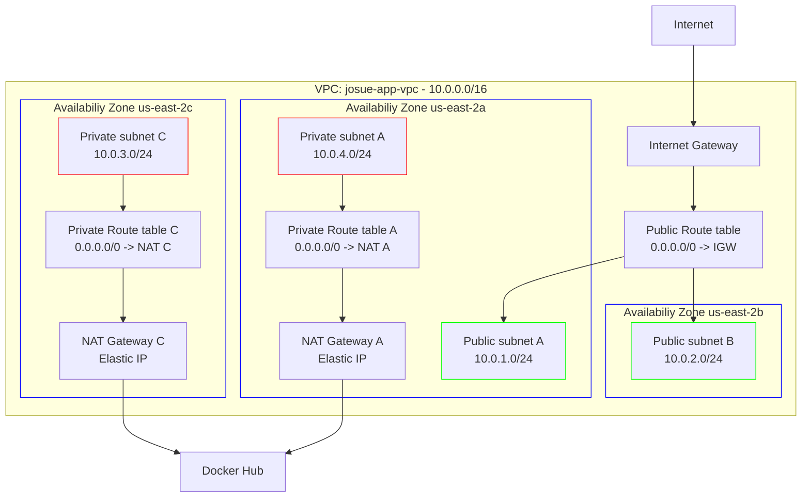

# 1. Crear VPC con subredes
Crear 4 subredes para cumplir con las reglas de AWS, seguridad y supervivencia ante caídas, 2 para ELB y 2 para RDS.
## Servicios utilizados
- Console de AWS
- IAM
- VPC
  - Subnets
  - Route tables
  - Internet Gateways
  - Elastic IPs
  - NAT Gateways

## Región
- United States (Ohio) / use2-az1

## Permisos de IAM
- "ec2:DescribeVpcs",
- "ec2:DescribeInternetGateways",
- "ec2:DescribeSubnets",
- "ec2:DescribeRouteTables",
- "ec2:DescribeNatGateways",
- "ec2:DescribeAddresses",
- "ec2:DescribeAvailabilityZones",
- "ec2:DescribeAccountAttributes",
- "ec2:DescribeTags"
- "ec2:CreateVpc",
- "ec2:CreateTags",
- "ec2:ModifyVpcAttribute",
- "ec2:CreateInternetGateway",
- "ec2:AttachInternetGateway",
- "ec2:CreateSubnet",
- "ec2:ModifySubnetAttribute",
- "ec2:CreateRouteTable",
- "ec2:AssociateRouteTable",
- "ec2:CreateRoute",
- "ec2:AllocateAddress",
- "ec2:CreateNatGateway",
- "ec2:AssociateAddress"
## VPC
  - Crear VPC
  - VPC > Your VPCs > Create VPS
    - VPC only
    - Name tag: ```josue-app-vpc```
    - IPv4 CIDR manual input: ```10.0.0.0/16```
## Internet gateways
  - Crear Internet Gateway
  - VPC > Internet gateways > Create internet gateway
    - Name tag: ```josue-app-vpc-igw```
  - Conectar GW a VPC
    - Actions > Attach to a VPC
      - Available VPCs: Seleccionar la recién creada
## Subnets
  - Crear la subredes
    - VPC > Subnets > Create subnet
    - 1er Red publica
      - Seleccionar la VPC
      - Subnet name: ```josue-app-public-subnet-2a```
        - ```2a``` es una de las zonas de diponibilidad
      - Availability Zone: ```United States (Ohio) / use2-az1 (us-east-2a)
      - IPv4 VPC CIDR block: ```10.0.0.0/16```
      - IPv4 subnet CIDR block: ```10.0.1.0/24```
    - 2da Red publica
      - Seleccionar la VPC
      - Subnet name: ```josue-app-public-subnet-2b```
        - ```2b``` es una de las zonas de diponibilidad
      - Availability Zone: ```United States (Ohio) / use2-az1 (us-east-2b)
      - IPv4 VPC CIDR block: ```10.0.0.0/16```
      - IPv4 subnet CIDR block: ```10.0.2.0/24```
    - 1ra Red privada
      - Seleccionar la VPC
      - Subnet name: ```josue-app-private-subnet-2c```
        - ```2c``` es una de las zonas de diponibilidad
      - Availability Zone: ```United States (Ohio) / use2-az1 (us-east-2c)
      - IPv4 VPC CIDR block: ```10.0.0.0/16```
      - IPv4 subnet CIDR block: ```10.0.3.0/24```
    - 2da Red privada
      - Seleccionar la VPC
      - Subnet name: ```josue-app-private-subnet-2a```
        - ```2a``` es una de las zonas de diponibilidad
      - Availability Zone: ```United States (Ohio) / use2-az1 (us-east-2a)
      - IPv4 VPC CIDR block: ```10.0.0.0/16```
      - IPv4 subnet CIDR block: ```10.0.4.0/24```
  - Por defecto **todas** las subnets se crean con una única Route table: ```Destination: 10.0.0.0/16 Target: local``` es decir **Privadas**.
## Route tables publica
Se crea una sola tabla de enrutamiento
  - Crear tabla de enrutamiento
    - VPC > Route tables > Create route table
    - Name: ```jornadas-cae-public-subnets-rt```
    - VPC: Seleccionamos la VPC
  - Asociar subnets
    - En detalles de la Route table > Subnet associations > Edit Subnet associations
      - Seleciona las dos subnets publicas: ```josue-app-public-subnet-2a``` y ```josue-app-public-subnet-2b```
  - Crear un nuevo registro de Rutas
    - En detalles de la Route table publica > Route > Edit routes
      - Edit routes > Add route
      - Destination: ```0.0.0.0/0```
      - Target: ```Internet Gateway``` Selecciona la creada anteriormente
## NAT gateways
Las subnets privadas deben poder conectarse con internet para acceder a registry u otros servicios.
```text
subnet-private --> Internet (Permitido)
Internet -- x ->  subnet-private (Bloqueado)
```
Crear dos gateways (una por subnet privada) por higiene
  - Crear las NAT gateways
    - VPC > NAT gateways > Create NAT gateway
    - 1er NAT gateway
      - Name: ```josue-app-private-subnet-2c```
      - VPC: Selecciona la VPC 
    - 2da NAT gateway
      - Name: ```josue-app-private-subnet-2a```
      - VPC: Selecciona la VPC 
  - Asignar NATs a Route table
    - Se crean DOS Route tables
      - VPC > Route tables > Create route table
      - 1er Rute table
        - Name: ```josue-app-private-subnet-2c-rt```
        - VPC: Seleccionamos la VPC
      - 2da Rute table
        - Name: ```josue-app-private-subnet-2a-rt```
        - VPC: Seleccionamos la VPC
    - Crear nueva Route table para cada NAT gateway
      - En detalles de la Route table privada > Route > Edit routes
        - NG 2c
          - Edit routes > Add route
          - Destination: ```0.0.0.0/0```
          - Target: ```NAT Gateway``` Selecciona la que corresponde a la NAT gateway (2c)
        - NG 2a
          - Edit routes > Add route
          - Destination: ```0.0.0.0/0```
          - Target: ```NAT Gateway``` Selecciona la que corresponde a la NAT gateway (2a)
    - Asociar subnet a cada Route table
      - RT1
        - En detalles de la Route table privada > Subnet associations > Edit subnet associations
          - Seleccionamos la que correcponde (2c)
      - RT2
        - En detalles de la Route table privada > Subnet associations > Edit subnet associations
          - Seleccionamos la que correcponde (2a)

## 2. Diagrama representativo


## 3.Eliminar Recursos
1. NAT Gateways
2. Direcciones IP elásticas (EIP)
3. Rutas y tablas de enrutamiento
   1. Quitar asociacion de subnets
4. Subredes y VPC